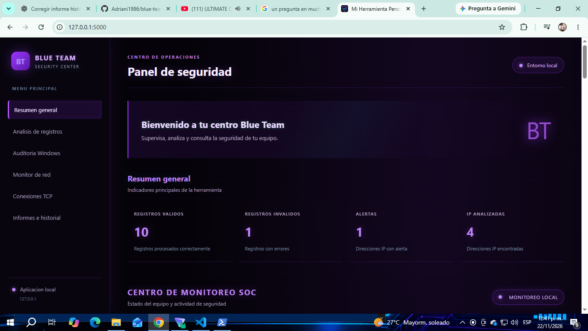
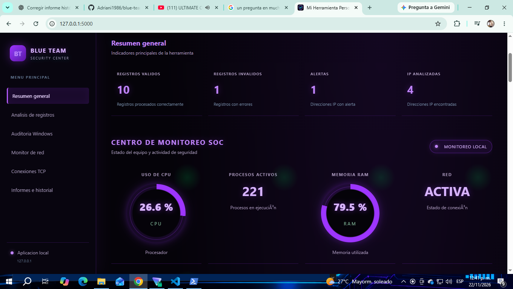
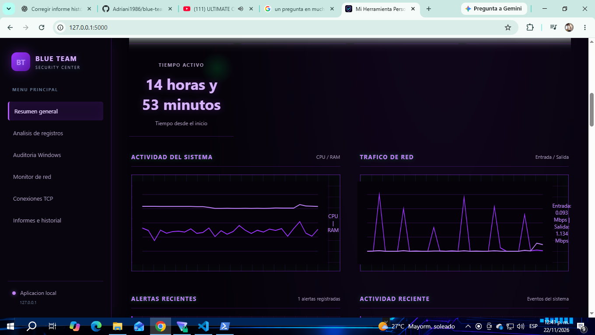
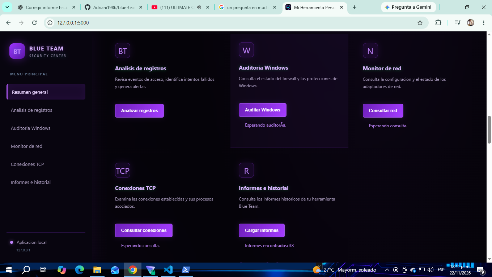
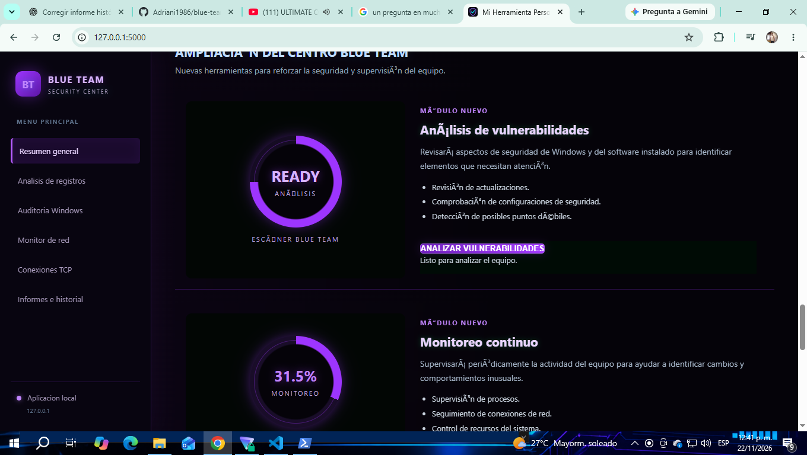
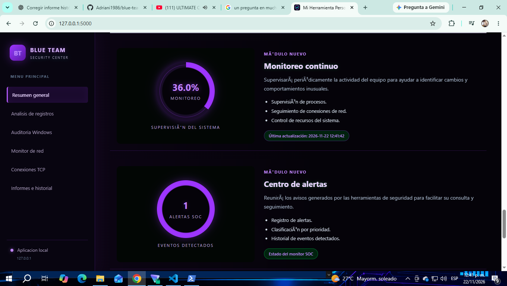

# Blue Team Security Monitor

> Herramienta de monitorización y análisis de seguridad desarrollada en Python y Flask para un entorno Windows local.



## Sobre el proyecto

**Blue Team Security Monitor** es una herramienta de seguridad desarrollada para centralizar diferentes funciones de supervisión y análisis de un sistema Windows desde una interfaz web local.

El proyecto comenzó como una herramienta de monitorización y fue evolucionando hasta integrar capacidades orientadas a **Blue Team, análisis de sistemas y detección de eventos**.

### Capacidades principales

- Análisis de registros y detección de eventos.
- Auditoría de configuraciones de seguridad de Windows.
- Monitorización de red y adaptadores.
- Consulta de conexiones TCP y procesos asociados.
- Generación y consulta de informes históricos.
- Registro e historial de alertas.
- Análisis de vulnerabilidades.
- Monitorización de recursos y actividad del sistema.

## Arquitectura del proyecto

La aplicación utiliza **Python + Flask** como base para el servidor y organiza las funciones de seguridad mediante módulos especializados.

El objetivo del diseño es separar las distintas tareas de análisis para facilitar su mantenimiento, pruebas y evolución.

```text
Blue Team Security Monitor
│
├── Flask Web Application
│
├── Log Analysis
├── Windows Audit
├── Network Monitor
├── TCP Connections
├── Reports & History
├── Detection / Alerts
├── Vulnerability Analysis
└── System Monitoring
```

## Capturas de la herramienta

### 01 — Dashboard principal

Vista general del centro de operaciones y los principales indicadores de seguridad.


### 02 — Monitorización del sistema

Indicadores de CPU, memoria, procesos y estado de red.



### 03 — Actividad y tráfico de red

Visualización de actividad del sistema y tráfico de red.



### 04 — Módulos de seguridad

Acceso a análisis de registros, auditoría de Windows, monitorización de red, conexiones TCP e informes.



### 05 — Análisis de vulnerabilidades

Módulo orientado a revisar aspectos de seguridad del sistema y generar información para su análisis.



### 06 — Monitorización continua y alertas

Seguimiento de actividad y centralización de eventos detectados.



## Metodología de seguridad

El desarrollo del proyecto se acompaña de un entorno de laboratorio separado para practicar pruebas de seguridad controladas.

El proceso utilizado es:

**Observar → Identificar → Probar → Analizar → Corregir → Validar**

Esto permite utilizar técnicas de evaluación desde una perspectiva controlada y posteriormente comprobar que las medidas defensivas aplicadas producen el resultado esperado.

### Ejemplo de validación

Durante las pruebas del laboratorio se identificó una configuración en la que SMB signing estaba habilitado, pero no era obligatorio.

La configuración fue endurecida y posteriormente validada desde una máquina Kali independiente.

Resultado final:

```text
Message signing enabled and required
```

El cambio fue comprobado externamente después de la remediación, en lugar de asumir que la modificación había sido efectiva únicamente por la configuración local.

## Separación entre entorno real y demo pública

La herramienta utilizada durante el desarrollo y las pruebas locales permanece separada de la versión pública.

La **demo pública** utiliza datos ficticios y está diseñada para mostrar las capacidades del proyecto sin exponer información sensible del entorno local.

Esta separación permite mantener:

- Herramienta local con funcionamiento real.
- Entorno de laboratorio independiente para pruebas.
- Demo pública sanitizada para portfolio.

## Objetivo profesional

Este proyecto forma parte de mi formación práctica en ciberseguridad, con especial interés en:

- Blue Team.
- Seguridad de Windows.
- Redes.
- Análisis y detección.
- Python aplicado a ciberseguridad.
- Validación de controles de seguridad.
- Metodologías de laboratorio Red Team / Blue Team.

El objetivo es continuar evolucionando la herramienta mientras desarrollo una metodología de trabajo basada en **evidencia, pruebas controladas, análisis, remediación y validación**.

## Demo pública

La versión pública y sanitizada del proyecto se encuentra separada de la herramienta local:

**GitHub:**  
https://github.com/Adriani1986/blue-team-security-monitor-demo

> La demo utiliza datos ficticios y no consulta el equipo real.

## Nota

Las pruebas de seguridad se realizan exclusivamente dentro de un entorno de laboratorio controlado y separado del entorno utilizado para la demo pública.
